<!-- ==================== BANNER ==================== -->

  

<!-- ==================== HERO SECTION ==================== -->

 

<h3>Building Ideas Into Digital Experiences.</h3>

  <i>Informatics Student • Developer • Technology Enthusiast</i>

 

  

---

<!-- ==================== ABOUT ME ==================== -->

## ABOUT ME

Hello! I'm **Eben Manurung**, an Informatics student interested in building software solutions and exploring modern technologies.

I enjoy learning, experimenting, and developing projects that combine programming, data, and technology.

- Studying Informatics and software development.
- Exploring Python and web development.
- Interested in Data Analytics and Artificial Intelligence.
- Learning Machine Learning and data processing.
- Developing academic and personal software projects.

 

---

<!-- ==================== CURRENTLY WORKING ==================== -->

## CURRENTLY WORKING ON

### LiDARVision

**Automotive LiDAR Point Cloud Classification**

An academic project focused on developing a web-based platform for 3D object classification using automotive LiDAR point cloud data.

**Main technologies and concepts:**

- Python
- XGBoost
- Random Forest
- LiDAR Point Cloud
- 3D Feature Extraction
- Machine Learning
- Web Development

*Status: Academic project in development.*

---

<!-- ==================== TECH STACK ==================== -->

## TECH STACK & TOOLS

### Programming Languages

### Development Tools

### Data & Machine Learning

---

<!-- ==================== PROJECTS ==================== -->

## FEATURED PROJECTS

  

---

<!-- ==================== GITHUB ANALYTICS ==================== -->

## GITHUB ANALYTICS

 

---

<!-- ==================== TROPHIES ==================== -->

## GITHUB TROPHIES

---

<!-- ==================== ACTIVITY GRAPH ==================== -->

## CONTRIBUTION ACTIVITY

---

<!-- ==================== BOMBERMAN ==================== -->

## BOMBERMAN CONTRIBUTION GRAPH

 

<i>Turning contributions into explosions of progress.</i>

---

<!-- ==================== CONNECT ==================== -->

## LET'S CONNECT

  Interested in technology, collaboration, or development projects?
  Feel free to connect with me.

 

  

  

---

<!-- ==================== FOOTER ==================== -->

### "Keep Learning. Keep Building. Keep Innovating."

 

<i>Designed & Built by Eben Manurung</i>

  

